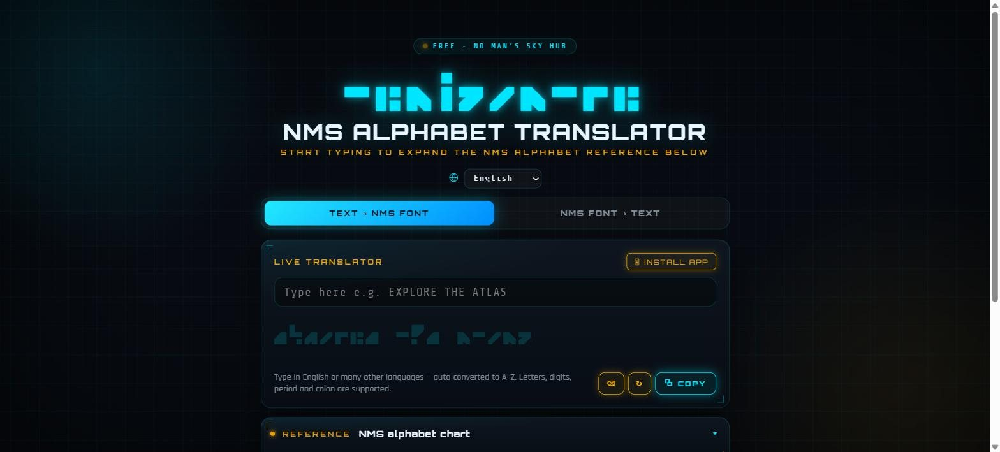
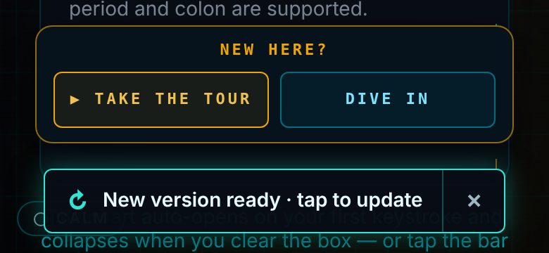
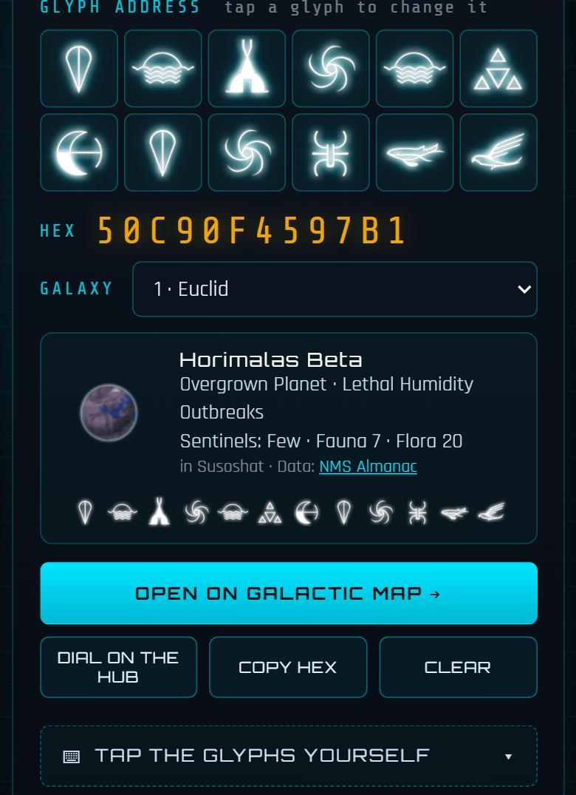
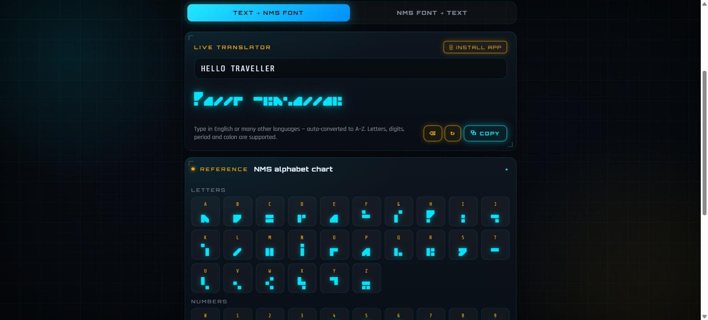
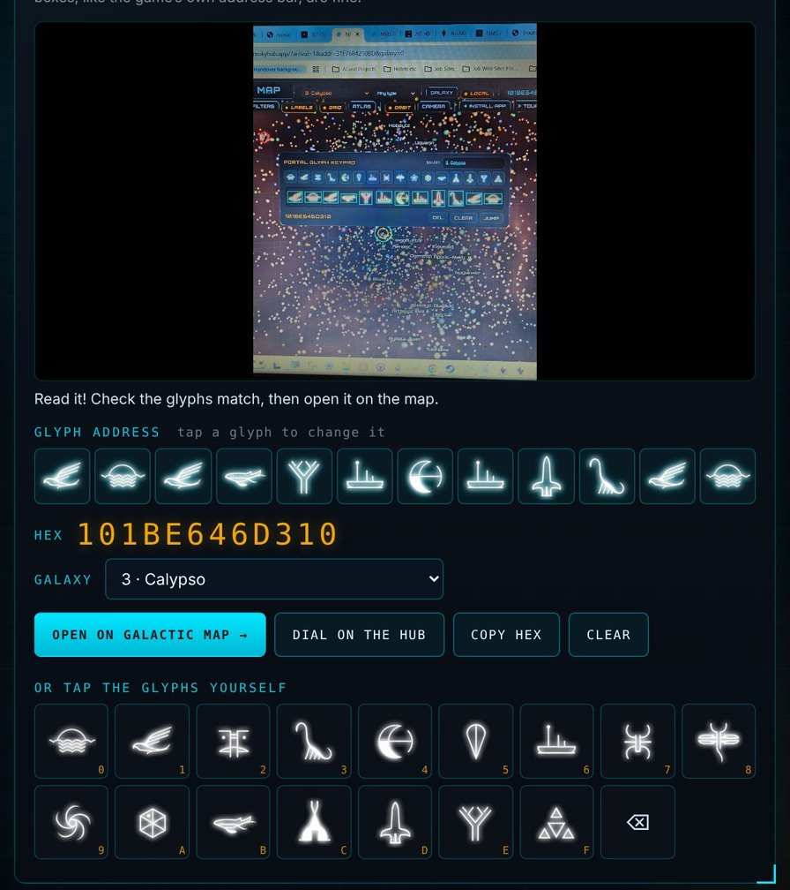
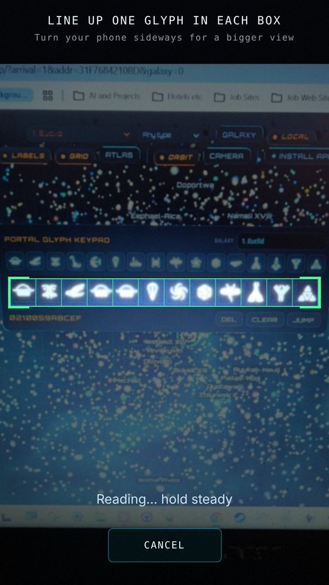
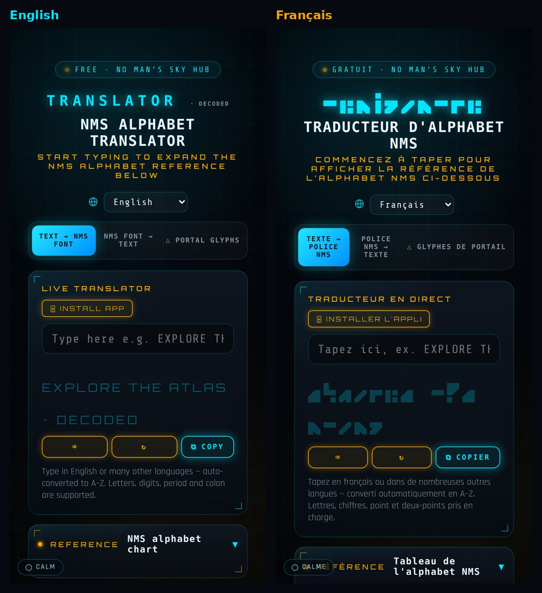
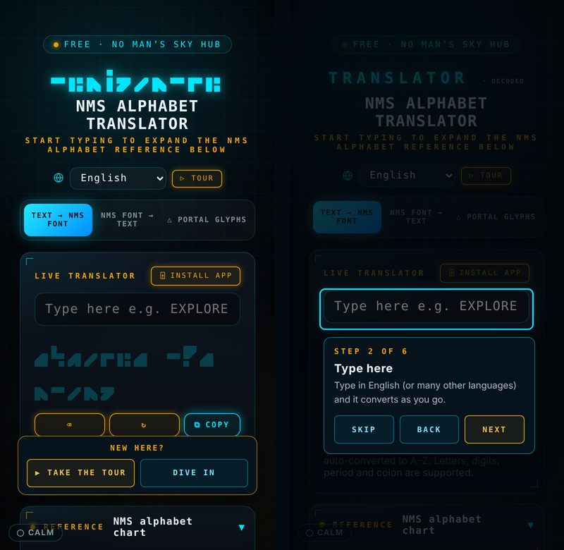

# NMS Alphabet Translator

**Live:** [translator.nomansskyhub.app](https://translator.nomansskyhub.app)

Write in the alphabet of *No Man's Sky*, decode it back to English, or read a portal address straight from a screenshot. Free, no account, and it installs as an app on phones and desktops.

Part of the [No Man's Sky Hub](https://nomansskyhub.app) family of fan tools.

## What it does

- **Text to NMS font.** Type and see your words rendered live in the NMS alphabet, then copy them.
- **NMS font to text.** Tap glyph tiles to build a word and read it back in English.
- **Ten languages.** English, Español, Deutsch, Nederlands, Polski, Français, Português (Brasil) and Italiano, plus 中文 and Русский on this page. Accented and non-Latin text is converted to A–Z automatically. The language list follows the choice shared by the whole No Man's Sky Hub family (pick it on any site and this page follows, and the other way round); 中文 and Русский stay on this page only. Names, glyphs and portal addresses stay as they are. It uses `lang.js`, the same file on every site, with packs in `lang/`. When you pick a language, an anonymous count of which one goes to the site's cookie-free GoatCounter stats, so we can see which languages people use.
- **Always the newest version.** An installed app on a phone isn't reloaded when you switch back to it, so it could keep showing an old version until it was closed and reopened. Now, each time you come back to it (and every 30 minutes while it stays open), it checks for a new version. If one is live, a small bar says “New version ready · tap to update”, in your language. One tap reloads in place; × hides it. It never reloads by itself, so nothing you're in the middle of is lost. It lives in `nms-update.js`, the same file on every site.

  

- **Portal glyph reader.** Drop, paste or pick a screenshot showing the 12 portal glyphs in a row (photo mode, a discovery page, a Reddit post), or tap **Scan with camera** and point your phone at the screen: like a bank-card scanner it reads the live picture and fills the glyphs in by itself once every box agrees over several camera frames. The camera view shows 12 boxes: line up one glyph in each box and every box is read on its own, so glyphs that touch are kept apart. If the picture also shows the galaxy (for example "GALAXY 1. Euclid" on the Map's keypad), the galaxy is read and set too. The game's own boxed glyph bar works too. It finds the row, matches each glyph against the 16 portal glyph shapes, and marks any it isn't sure of in amber so you can tap to fix them. Then open the address on the [Galactic Map](https://map.nomansskyhub.app) or dial it on the Hub. Everything runs in your browser; the image is never uploaded (reading the galaxy name downloads a small text-reading engine the first time, but the picture stays on your device). If it can't find the row, drag a box around the glyphs. You can also tap the glyphs in yourself: the keypad is folded behind **Tap the glyphs yourself** (tapping an empty glyph box opens it), and closes again once all 12 are in. You can also type or paste the hex address straight into the **Hex** box (handy for fixing a glyph the camera misread): each digit updates its glyph box, and a `?` leaves one empty.
- **Planet tile.** Once 12 glyphs are in, a tile under the hex and galaxy shows the planet that address lands on: its picture, real name, type, weather, sentinels, fauna and flora counts, the system it's in, and the address as glyphs. The data comes from [NMS Almanac](https://nmsalmanac.com), looked up through the Galactic Map's server so the Almanac key never reaches your browser. If a traveller has edited that planet on the Galactic Map, their edit is shown instead. Under it, **🖼 Planet card** gives you the Almanac's own picture of that planet (disc, name, facts, galaxy and glyphs): on a phone it opens the share sheet so you can send it to a chat, elsewhere it opens the picture to save.

  
- **Reference chart.** Every letter, digit, period and colon side by side with its glyph. It opens on your first keystroke and folds away when you clear the box.
- **Installable app** that also works offline.
- **Calm mode.** A small **Calm** switch in the bottom-left corner swaps the patterned and image backgrounds for a plain dark one, for anyone who finds the page busy. It's shared across the whole No Man's Sky Hub family (one switch turns it on for every site) and lives in `calm.js`.

## New here? Take the tour

First-time visitors get a small **New here? ▶ Take the tour / Dive in** box (shown once, never again). The tour dims the page and spotlights the three modes, the text box, your NMS text, portal glyphs, the alphabet chart and the language picker, one step at a time with Back / Next / Skip. Replay it any time from the **▷ TOUR** button. The phone's Back button closes it, and it's translated into every language the site offers. Shared `nms-tour.js`, the same file on every nomansskyhub.app site.

## How it's built

A plain HTML/CSS/JavaScript site with no build step. Deployed on Netlify straight from this repo: every push to `main` goes live.

| File | What it is |
|---|---|
| `index.html` | The translator: layout, logic and the embedded alphabet font |
| `hub-skin.css`, `hub-skin.js` | The No Man's Sky Hub look: fonts, atmosphere, glyph header, panels |
| `glyph-reader.js`, `glyph-reader.css` | Portal glyph reader: finds the 12-glyph row, matches shapes, keypad and links to the Map/Hub |
| `glyphs/`, `galaxies.json` | The 16 portal glyph images (also the matching templates) and the 256 galaxy names |
| `sw.js` | Service worker for offline use |
| `manifest.json`, `pwa/` | App install details and icons |
| `alphabet-translator-404.html` | Not-found page |
| `lang.js`, `lang/`, `fonts/` | Language choice and translations, shared by every Hub site |

## Credits

- NMS Alphabet font by seontonppa (built with FontStruct), used with permission
- Planet data in the planet tile comes from **[NMS Almanac](https://nmsalmanac.com)** by Borjomi (u/Fosferus) — thanks for letting the Hub use it

## Using this code?

It's free to use under the MIT licence. If you use any of it in your own project, site, video or post, please credit **elegra1965 / No Man's Sky Hub** with a link to [nomansskyhub.app](https://nomansskyhub.app). The MIT licence also asks you to keep the copyright notice in `LICENSE` with any copied code.

## Licence

The code is MIT licensed (see `LICENSE`). Game names and imagery belong to Hello Games and are not covered by that licence.

*An unofficial, fan-made project. Not affiliated with, sponsored by, or endorsed by Hello Games.*

Built by elegra1965.
